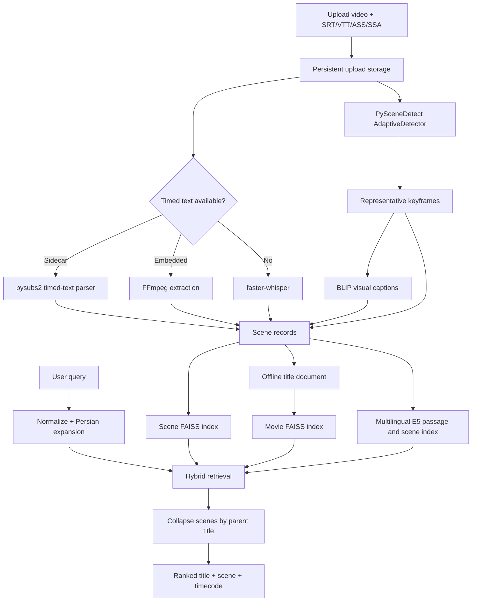

# CineScene Architecture

## Retrieval Contract

The primary user story is: **given a description of a remembered scene, return the correct movie or episode and the best matching timestamp.** CineScene models a title as a hierarchy instead of one long plot string.

```text
Title document
  +-- plot, genres, cast, director, mood, keywords
  +-- Scene 001: 00:00-00:14, dialogue, visual caption, tags, keyframe
  +-- Scene 002: 00:14-00:31, dialogue, visual caption, tags, keyframe
  +-- ...
```

## Data Flow



## Ingestion

`ingestion/offline_video.py` owns scene boundaries and the persisted scene contract.

- Uses PySceneDetect `AdaptiveDetector` when installed.
- Falls back to OpenCV histogram, pixel-difference, motion, and contrast signals.
- Enforces minimum and maximum scene duration to prevent noisy micro-cuts or very long segments.
- Persists a representative frame and rich record for every scene.
- Parses movie and `SxxExx` series identities and removes release tags from filenames.
- Recovers the offline catalog from persisted scene JSON if catalog files are stale.

`ingestion/media_intelligence.py` owns optional media models.

- FFmpeg discovers and extracts an embedded subtitle stream.
- SRT/VTT/ASS/SSA sidecars are decoded and merged into half-open scene time ranges without truncating dialogue.
- faster-whisper generates timed dialogue when no subtitle track exists.
- BLIP generates a natural-language caption from each keyframe.
- Capability discovery keeps optional models observable from the System screen.

Each `SceneRecord` contains:

```text
parent video id, title, scene number, start/end/duration
transcript, subtitle sources
visual caption, caption source
mood tags, keywords, visual tags
brightness, motion, contrast, cut strength
keyframe path, source video path, analysis version
analysis warnings when requested evidence could not be recovered
```

## Indexes

### Movie index

`build_index_v2.py` embeds complete title documents. It provides broad recall for plot, cast, genre, director, and overall mood queries.

### Scene index

`scene_index.py` embeds every persisted scene independently. Its text includes the current transcript and visual caption plus local dialogue context from adjacent scenes. Metadata retains the parent title id, timestamp, and keyframe.

The scene builder reads the active movie-index model so vector dimensions always match. Index files are written separately:

```text
data/index/movies.index
data/index/metadata.pkl
data/index/scenes.index
data/index/scene_metadata.pkl
```

## Ranking

### Default Hybrid Engine

`hybrid_search.py` is the native engine; `docs/assets/semantic-worker.mjs` and `hybrid-ranking.mjs` implement its portable public counterpart. `scripts/build_browser_index.py` exports public-only normalized vectors, precomputed BM25 posting contributions, processor rules and evidence references. The manifest pins model revisions and hashes catalog/vector/posting files. Private source paths and unallowlisted local scenes are excluded.

1. Normalize and expand the query in `query_processor.py`.
2. English queries use BGE title/scene vectors, E5-base passages and BM25. Persian queries use E5-base passages; generic bilingual concept expansion may add BGE/BM25 recall when enough English concepts are available.
3. Add lexical evidence from title, plot, scene transcript, captions, tags, and metadata.
4. Prefer transcript overlap for dialogue-like scene queries.
5. Collapse title, scene and episode evidence to one parent title using maximum score, not document-count bonuses.
6. Preserve the best scene and a short list of additional matching scenes.
7. Return a stable ranked response with title score, scene score, frame, and timecode.

MiniLM cross-encoder reranking is enabled by default for 40 candidates, in batches of four. It scores English descriptions or expanded English concepts, never raw Persian with an English-only model. Raw logits and fusion values are never mixed as comparable scores. The unscored tail remains after the reranked shortlist. A rank-consensus ablation improved some broad queries but hurt the targeted identity suite and was not selected as the release policy. Scores are ranking signals, not calibrated confidence percentages.

Both runtimes use pinned int8 ONNX query inference. BGE uses CLS pooling and its query instruction; E5 uses masked mean pooling and query/passage prefixes. Encoders load sequentially and release their sessions; ONNX CPU memory arenas/patterns are disabled. The browser reports downloads, supports cancellation and verifies data checksums. Inference stays on-device, while model downloads contact Hugging Face. Optional BLIP/Whisper analysis runs in a child process with structured progress and exits before index refresh.

TVmaze episode records have a unique record ID and a parent show ID. Their summaries and season/episode/source metadata remain distinct from recovered video scenes: no timestamp or transcript is fabricated. A matching episode is returned as `matched_episode`; its synopsis can be inspected independently of the series overview. See [Data sources](DATA_SOURCES.md).

### Experimental Passage Engine

`CINESCENE_SEARCH_ENGINE=passages` selects the E5-small full-plot ablation. Its assets live under `data/index/passage_experiment/`, not the public release. It was not selected as the default because the broader development benchmark regressed. Preserve the failed experiment report rather than presenting one corrected example as general accuracy.

The output is parent-title oriented, so ten matching moments from one movie do not occupy ten result cards.

## API And Jobs

`backend/main.py` exposes:

| Route | Purpose |
| --- | --- |
| `GET /api/health` | Model, CUDA, movie index, scene index, and crawler diagnostics |
| `POST /api/search` | Hybrid scene-to-title retrieval |
| `POST /api/ingest/video` | Chunked multipart video/subtitle upload |
| `POST /api/crawl/offline-async` | Recursive local-folder ingestion |
| `GET /api/crawl/status` | Documents, scenes, keyframes, and capabilities |
| `GET /api/jobs/{id}` | Background pipeline progress |
| `GET /api/media/{id}/scenes` | Full paginated timeline, text search, and dialogue/vision filters |
| `GET /api/media/{id}/clip/{scene}` | Cached browser-compatible H.264/AAC scene preview |
| `POST /api/index/rebuild` | Full movie and scene index rebuild |
| `/media/videos/*` | Local source playback for authorized ingestions |
| `/media/keyframes/*` | Scene frame delivery |

Uploads are size-limited, streamed to disk, and analyzed in a background job. A successful ingestion refreshes the scene index and clears the cached search engine so the title is searchable without restarting the app.

Embedding-model creation is protected by a process-wide re-entrant lock. Health checks and searches therefore cannot cold-load two copies of BGE-large concurrently after an index refresh, which is important on a 4 GB GPU.

Media/index writers are serialized with a pipeline lock. Job status is persisted in SQLite; the browser restores the active job after refresh. A server restart explicitly marks interrupted jobs as failed for retry instead of claiming completion or silently losing them. This is not an auto-resuming distributed worker queue.

## Frontend

The backend-connected app in `frontend/` contains four workspaces:

- **Discover:** scene query, ranked results, keyframes, timestamps, and local scene playback.
- **Scene Lab:** drag/drop upload, subtitle tracks, analysis profiles, progress, and complete searchable timeline explorer.
- **Library:** persistent history, favorites, and ingestion records.
- **System:** runtime capabilities and index diagnostics.

The public `docs/` build shares the visual language and browser memory. GitHub Pages serves its static assets, while semantic inference runs inside the browser. Python/GPU video ingestion still requires Studio; selecting a video in the public PWA previews it but does not claim to analyze it.

## Storage And Recovery

- SQLite stores user memory and ingestion history.
- `CINESCENE_STORAGE_ROOT` routes model caches and temporary uploads to a chosen drive. This workstation's `models/` and `data/` are NTFS junctions to E, so media, indexes, model weights, and preview clips do not accumulate on C.
- Source media and generated model data are ignored by Git.
- Scene JSON files are the durable recovery source for offline documents.
- Movie and scene indexes can be regenerated from catalog and scene records.
- The crawler never requires access to a protected streaming player or DRM bypass.
- Public catalog exports include only explicitly allowlisted local demo titles. Private uploaded media, transcripts, captions, and local paths are not published to GitHub Pages.

## Evaluation

`benchmarks/cases.json` contains 27 development regression queries. Exact normalized title/alias matching distinguishes sequels and can check season/episode identity. Reports include failures and per-category metrics. The suite has informed development, so it is not an independent held-out estimate. `baseline-v2.json` preserves the original engine's score under the corrected matcher; current reports use the same suite hash.
