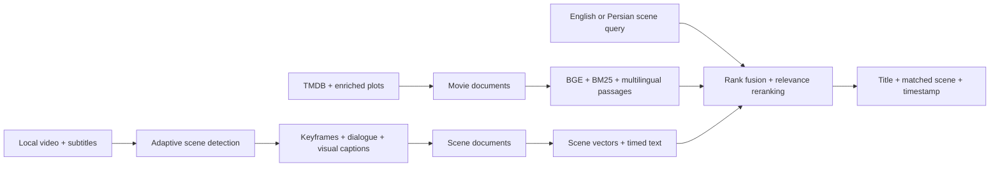

# CineScene

<p align="center"></p>

**Scene-to-title retrieval for movies and series.** Describe a scene, line of dialogue, visual detail, or mood and CineScene returns the most likely title together with the matching scene, timestamp, transcript, and keyframe.

[Open the installable PWA](https://amin-pourmand.github.io/cinescene) | [Architecture](ARCHITECTURE.md) | [Demo guide](FINAL_DEMO_GUIDE.md)

## Why CineScene

Traditional movie search depends on titles, actors, or exact keywords. CineScene indexes two distinct kinds of evidence:

- overlapping story passages from available plots;
- individual timestamped scenes from authorized video/subtitle ingestion.

The runtime combines BGE-large semantic retrieval, BM25, a multilingual E5-base channel for Persian, and MiniLM cross-encoder reranking. Studio and the public PWA use the same ranking design, with private media excluded from the public export. Evidence is max-pooled by parent title. Plot and episode summaries are never labeled as extracted video scenes. Scores are ranking signals, not confidence percentages.

## Feature Set

- Movie and series retrieval, with separately indexed, attributed episode summaries.
- Separate scene index with timestamp-level matches.
- In-app drag-and-drop upload for video and multiple SRT/VTT/ASS/SSA files.
- Recursive movie and series folder crawler.
- PySceneDetect adaptive cut detection with an OpenCV fallback.
- FFmpeg extraction of embedded subtitle streams.
- `faster-whisper` speech-to-text when subtitles are unavailable.
- BLIP keyframe captions for visual scene understanding.
- Automatic catalog and scene-index refresh after ingestion.
- Movie/series filename parsing, including `S01E01` metadata.
- Persian and English scene queries.
- Full title details, save/remove controls, search history with confirmation, and SQLite persistence.
- Shareable search links, recent searches, persistent preferences, and keyboard-accessible mobile navigation.
- Responsive frontend, local media playback, and an installable public PWA.
- Complete, searchable timelines with pagination, dialogue/vision filters, and H.264 scene previews.
- Durable background-job progress and recovery after page refresh.
- A multilingual E5 retrieval channel with plot passages beyond a single embedding context window.

## Architecture



See [ARCHITECTURE.md](ARCHITECTURE.md) for component and data-contract details.

## Run The Full Studio

```powershell
python -m venv .venv
.\.venv\Scripts\python.exe -m pip install -r requirements.txt
.\.venv\Scripts\python.exe scripts/prepare_onnx_models.py bge multilingual reranker
.\.venv\Scripts\python.exe app.py
```

Open `http://127.0.0.1:8000`.

The default `hybrid` engine reads local FAISS indexes and metadata. Prepare the pinned quantized ONNX weights first; the optional `passages` engine is an experimental E5-small ablation, not the release default. On this development machine, `.venv/`, `models/`, and `data/` are directory junctions into `E:\CineSceneCache\cinescene`; `.env` routes model caches and multipart temporary files there too. Existing Python commands continue to use the same project path. See `.env.example` to configure another machine. The indexes and licensed source data are not model weights; a fresh checkout must import/build them before Studio search is available.

The first screen is **Search**. **Your videos** contains uploads, processed timelines, and folder imports; **Saved & history** manages saved titles and past queries; **Settings** holds preferences and expandable runtime diagnostics. English is the interface language, with automatic text direction for Persian searches.

## Process A Video

1. Open **Your videos > Add a video**, then drop an MP4, MKV, MOV, AVI, or WEBM file into **Media source**.
2. Optionally attach one or more SRT/VTT/ASS/SSA subtitle tracks.
3. Expand **Processing settings**. Keep **Embedded subtitles** enabled for MKV subtitle extraction.
4. Enable **Speech transcription** when the media has no subtitles.
5. Enable **Visual captioning** for BLIP-based keyframe descriptions.
6. Select **Process video**.
7. Search for a line, action, object, lighting condition, or mood in **Search**.

Ingestion is a background job. The UI reports upload progress, scene detection, media intelligence, vector indexing, and the final scene timeline. A full movie-index rebuild is not required after an upload because the independent scene index refreshes automatically.

Use **Explore scenes** to browse the complete timeline, search a dialogue fragment, filter recovered dialogue or vision captions, and play a selected scene. Scene previews are generated and cached as H.264/AAC clips, including when the source container or codec is unsupported by the browser. **Settings > Runtime diagnostics** reports actual dialogue and vision coverage separately from catalog size.

Scene-index refresh reuses vectors only when scene identity, retrieval text, model, precision and context length match. A changed caption/dialogue/context is re-encoded. The repeated synthetic upload reused all 158 scene vectors and existing title passages: preparation fell from 224.95 s to 36.61 s on this CPU development machine. This is a local acceptance observation, not a general processing-speed guarantee.

## Offline Pipeline

```text
video upload or local folder
  -> persistent media storage
  -> adaptive scene boundaries
  -> representative keyframe per scene
  -> sidecar / embedded subtitles
  -> optional faster-whisper transcript
  -> optional BLIP visual caption
  -> mood, keyword, motion, light, and contrast signals
  -> scene JSON + offline catalog document
  -> scene FAISS index
  -> hybrid scene-to-title retrieval
```

Generated local data:

```text
data/offline_videos/uploads/
data/processed/video_ingestion/*_scenes.json
data/processed/video_ingestion/keyframes/
data/processed/offline_media_enriched.json
data/processed/cinescene_catalog.json
data/index/movies.index
data/index/scenes.index
```

## Folder Crawler

**Your videos > Import a folder** accepts a local folder path. Use **Check folder** to inspect detected media, choose that form's independent **Processing settings**, then select **Import videos**. The CLI equivalent is:

```powershell
.\.venv\Scripts\python.exe .\scripts\crawl_offline_videos.py "D:\Series" --min-scene-sec 4 --max-scene-sec 45 --threshold 0.35 --sample-fps 2
```

Recommended series naming:

```text
Show.Name.S01E01.mkv
Show.Name.S01E01.fa.srt
Show.Name.S01E01.en.srt
```

## Retrieval Model

The English encoder is BGE-large (1,024 dimensions, CLS pooling, L2 normalization and its retrieval-query instruction). Multilingual E5-base (768 dimensions, masked mean pooling and `query:`/`passage:` prefixes) adds passage recall across languages. Generic bilingual concept expansion can add English recall and reranking for Persian queries; it is not a full translation system. Reciprocal rank fusion combines retrieval channels; MiniLM reranks 40 candidates using summary and matching scene/episode evidence. Unscored retrieval values are never treated as comparable to relevance logits. Encoders load sequentially; CPU ONNX arenas are disabled to bound retained memory. Existing document vectors and new quantized document vectors have separate build provenance. Current models are pretrained; a training script is not evidence of successful fine-tuning.

The optional training pipeline generates positive relations and hard negatives, then trains with `MultipleNegativesRankingLoss` and curriculum stages:

```powershell
.\.venv\Scripts\python.exe build_triplets_v2.py
.\.venv\Scripts\python.exe finetune_v2.py --batch-size 4 --epochs 3
.\.venv\Scripts\python.exe build_index_v2.py --model models\bge-large-en-v1.5 --flat --batch-size 4
.\.venv\Scripts\python.exe scene_index.py
.\.venv\Scripts\python.exe multilingual_index.py --model models\multilingual-e5-base
```

The small batch size is intentional for a 4 GB GTX 1650 Ti.

## Validation

```powershell
.\.venv\Scripts\python.exe .\scripts\smoke_test_final.py
.\.venv\Scripts\python.exe .\scripts\retrieval_quality_benchmark.py
.\.venv\Scripts\python.exe .\scripts\runtime_acceptance.py --upload
.\.venv\Scripts\python.exe -m unittest discover -s tests -v
node .\scripts\visual_smoke_test.js
node .\scripts\workspace_smoke_test.js http://127.0.0.1:8000 --upload
node .\scripts\workspace_smoke_test.js http://127.0.0.1:4178 static
node .\scripts\pwa_offline_smoke.js http://127.0.0.1:4178
```

The retrieval benchmark reports Hit@1, Hit@5, MRR@10, per-query rank, and latency. Add `--api-url http://127.0.0.1:8000` to reuse a running engine without loading a second copy of the models. The visual test checks desktop/mobile layouts, browser errors, overflow, and decoded local video playback. Workspace tests cover title details, saving/removal, history confirmation, shared links, connection recovery, Persian input, folder probing/settings, and preferences. `--upload` additionally submits the tiny synthetic episode through the actual browser UI. Static/PWA tests expect `docs/` served on port 4178.

Run model and browser tests sequentially on memory-constrained Windows machines. Windows can expand its system-managed pagefile on C under memory pressure even when project files and caches are stored on E; relocating project caches does not relocate that operating-system file.

### Current CPU-ONNX Snapshot

The release uses query-relevant full-plot/passages in the relevance check, sourced parent-series context, explicit-intent genre filters and Persian inflection-aware concept expansion. It does not contain query-to-film rules. Existing full plots are searched lexically without re-encoding the whole catalog. Thirteen series title records were refreshed from the same attributed TVmaze import, including canonical genres; episode prose is unchanged.

| Manual suite | Hit@1 Before / After | Hit@5 Before / After |
| --- | ---: | ---: |
| New diverse development, 24 queries | 58.33% / 79.17% | 70.83% / 95.83% |
| Original development, 27 queries | 59.26% / 74.07% | 77.78% / 92.59% |
| Reserved final, 16 queries | 68.75% / 68.75% | 87.50% / 87.50% |
| Targeted identity, 12 queries | 75.00% / 66.67% | 91.67% / 100% |

The reserved titles are disjoint from development titles and were evaluated after the ranking policy was frozen. They are still manually authored checks, not an independent academic dataset. The reserved Persian descriptions of The Sixth Sense and The Martian remain failures (absent from top ten and rank 8 respectively); do not infer universal Persian understanding from the five successful development examples. Two English Edge of Tomorrow paraphrases regressed from first to second, although the exact reported query remains first. Three source-informed episode checks still identify the correct show and episode at rank 1. Full results, rejected ablations and reproducible commands are in [benchmarks](benchmarks/README.md).

### Historical Baseline

The earlier GTX 1650 Ti runtime produced the following development snapshot. These are historical measurements, not the current CPU-ONNX release results:

| Check | Result |
| --- | --- |
| Catalog vectors | 7,615 |
| Scene vectors | 158 |
| Total searchable vectors | 7,773 |
| Public series imported | 2,810 |
| Encoder | BGE large, 1,024 dimensions, CUDA FP32 |
| Regression suite | 27 queries with exact title/alias matching |
| Retrieval metrics | Current results in `benchmarks/latest.json` |
| Corrected-suite Hit@5 | 85.19%, compared with 55.56% for the original engine |
| Corrected-suite Hit@1 | 48.15%; first-result accuracy still needs improvement |
| Unit/regression tests | 35 passing locally; model-dependent ranking tests skip in lightweight CI |
| Browser QA | Desktop and mobile, zero JS errors and zero horizontal overflow |
| Upload E2E | Video + SRT -> 3 scenes -> 3 keyframes -> rank-1 scene result |

The previous ten-query report allowed substring title matches, which incorrectly counted sequels as the expected film. Version 2 uses exact normalized titles or explicit aliases, checks episode identity when specified, and reports films, series, Persian, and synthetic scenes separately. It is a development regression suite, not a held-out academic accuracy estimate. `benchmarks/baseline-v2.json` preserves the unmodified system's result under this stricter evaluation.

The saved local feature-film analysis contains 153 timestamped scenes: all 153 have BLIP captions and 115 contain recovered timed text. Two subtitle-fragment acceptance queries returned the correct film and scene (348.22s and 540.08s) at rank 1. This verifies that specific local evidence is searchable; it does not establish universal scene-recognition accuracy. Only three titles currently have full local timelines; the remaining catalog is title/plot metadata, not scene-by-scene knowledge.

## Expand The Catalog

The current index combines the enriched TMDB movie corpus with a normalized public series metadata snapshot. Rebuild or append the series portion with:

```powershell
.\.venv\Scripts\python.exe .\scripts\import_public_series_csv.py --input data\raw\tv_shows.csv
.\.venv\Scripts\python.exe .\scripts\append_catalog_to_index.py --input data\processed\tv_series_enriched.json
```

`scripts/import_tvmaze_series.py` is also available for environments with TVMaze API access. Provider metadata is treated as title-level recall; true scene retrieval still requires authorized video/subtitle ingestion through **Your videos**.

For deeper series evidence, the idempotent episode importer caches API responses on the data drive, rejects ambiguous show identities and empty summaries, and stores source URLs and CC BY-SA attribution. It does not create fake transcripts or timestamps:

```powershell
.\.venv\Scripts\python.exe scripts/expand_episode_dataset.py
.\.venv\Scripts\python.exe scripts/append_catalog_to_index.py --input data/processed/episode_expansion_documents.json --batch-size 4
.\.venv\Scripts\python.exe scripts/append_multilingual_documents.py
```

See [Data sources](DATA_SOURCES.md) and `data/processed/episode_expansion_report.json` for exact coverage and licensing. Rebuild the public catalog/index only after the local indexes finish updating.

## Public PWA

The `docs/` build is published at:

```text
https://amin-pourmand.github.io/cinescene
```

It contains an installable shell, browser memory, local-file preview, the full public catalog, episode evidence, and five extracted scene records from two synthetic fixtures. Search runs real hybrid inference in a Web Worker through Transformers.js/ONNX WASM, rather than substring keyword scoring. Queries stay on the device. Initial model downloads are about 650 MB, in addition to runtime/catalog/index assets. Model files are fetched from pinned Hugging Face revisions and cached by the browser. Loading, cancellation, cache removal and errors are explicit; there is no silent lexical fallback. Browser caches use the browser's configured profile storage, which may be on C; project storage settings cannot move that profile.

GitHub Pages cannot run Python or analyze uploaded feature films. Real video/subtitle ingestion still runs in the local FastAPI Studio. Optional speech/vision models run in a short-lived subprocess so their memory is released after analysis.

Refresh and publish it with:

```powershell
.\.venv\Scripts\python.exe .\scripts\build_pwa_catalog.py
.\.venv\Scripts\python.exe .\scripts\build_browser_index.py
.\.venv\Scripts\python.exe .\scripts\validate_public_index.py
.\scripts\publish_github_pages.ps1
```

## Responsible Use

CineScene processes local media that the operator has permission to analyze. It does not crawl protected streaming subscriptions, bypass DRM, or redistribute source video. A production integration with a media provider must use that provider's licensed API or authorized content feed.

The public-catalog builder strips local source paths and excludes local uploads entirely unless their title is explicitly allowlisted. Only the bundled synthetic demo titles are included by default. Additional authorized showcase media can be explicitly allowlisted with `CINESCENE_PUBLIC_MEDIA_TITLES` before running `scripts/build_pwa_catalog.py`; doing so publishes its scene text and keyframes.

## Main Components

| Path | Responsibility |
| --- | --- |
| `backend/main.py` | FastAPI routes, uploads, jobs, memory, and media URLs |
| `frontend/` | Full backend-connected Retrieval Studio |
| `ingestion/offline_video.py` | Scene detection and catalog document creation |
| `ingestion/media_intelligence.py` | FFmpeg, faster-whisper, and BLIP adapters |
| `core/passage_search.py` | Experimental E5-small ablation, not the release engine |
| `core/onnx_models.py` | Bounded-memory encoder and reranker inference |
| `hybrid_search.py` | Default hybrid retrieval and evidence ranking |
| `backend/media_worker.py` | Isolated speech/vision analysis subprocess |
| `scene_index.py` | Independent per-scene FAISS index builder |
| `query_processor.py` | English/Persian normalization and query expansion |
| `docs/` | Public installable PWA with on-device semantic inference |
| `scripts/` | Crawling, benchmarks, visual tests, and publishing |
