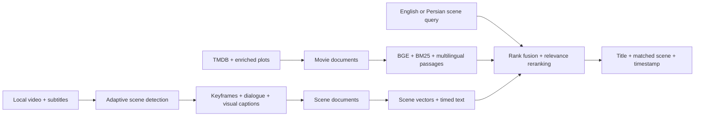

# CineScene

<p align="center"></p>

**Scene-to-title retrieval for movies and series.** Describe a scene, line of dialogue, visual detail, or mood. CineScene ranks candidate titles and shows the supporting passage; timestamps, transcripts and keyframes are available only for indexed video evidence.

[Open the installable PWA](https://amin-pourmand.github.io/cinescene) | [Architecture](ARCHITECTURE.md) | [Demo guide](FINAL_DEMO_GUIDE.md)

## Why CineScene

Traditional movie search depends on titles, actors, or exact keywords. CineScene indexes two distinct kinds of evidence:

- overlapping story passages from available plots;
- individual timestamped scenes from authorized video/subtitle ingestion.

The local Studio combines BGE-large semantic retrieval, BM25, multilingual E5-base, optional offline Persian sentence translation, and passage-level MiniLM verification. Evidence is max-pooled by parent title after verification. Plot and episode summaries are never labeled as extracted video scenes. Scores are ranking signals, not confidence percentages. The public PWA exports the same public evidence and independently verifies shortlisted passages using the corresponding browser models. Private media is excluded from the public export; identical numeric scores across native, Node CPU and browser WASM runtimes are not guaranteed.

## Feature Set

- Movie and series retrieval, with separately indexed, attributed episode summaries.
- Separate scene index with timestamp-level matches.
- In-app drag-and-drop upload for video and multiple SRT/VTT/ASS/SSA files.
- Recursive movie and series folder crawler.
- PySceneDetect adaptive cut detection with an OpenCV fallback.
- FFmpeg extraction of embedded subtitle streams.
- `faster-whisper` speech-to-text when subtitles are unavailable.
- BLIP keyframe captions for visual scene understanding.
- Automatic catalog and scene-index refresh after ingestion.
- Movie/series filename parsing, including `S01E01` metadata.
- Persian and English scene queries.
- Full title details, save/remove controls, search history with confirmation, and SQLite persistence.
- Shareable search links, recent searches, persistent preferences, and keyboard-accessible mobile navigation.
- Responsive frontend, local media playback, and an installable public PWA.
- Complete, searchable timelines with pagination, dialogue/vision filters, and H.264 scene previews.
- Durable background-job progress and recovery after page refresh.
- A multilingual E5 retrieval channel with plot passages beyond a single embedding context window.

## Architecture



See [ARCHITECTURE.md](ARCHITECTURE.md) for component and data-contract details.

## Run The Full Studio

```powershell
python -m venv .venv
.\.venv\Scripts\python.exe -m pip install -r requirements.txt
.\.venv\Scripts\python.exe scripts/prepare_onnx_models.py bge multilingual reranker
.\.venv\Scripts\python.exe app.py
```

Open `http://127.0.0.1:8000`.

The default `hybrid` engine reads local FAISS indexes and metadata. Prepare the pinned quantized ONNX weights first; the optional `passages` engine is an experimental E5-small ablation, not the release default. This development machine's physical checkout is now `E:\CineScene`; open that folder for future development. Its `.venv/`, `models/`, and `data/` are directory junctions into `E:\CineSceneCache\cinescene`; `.env` routes model caches and multipart temporary files there too. The old desktop folder retains compatibility links and a launcher, with a locked legacy Git directory pending closure of the old workspace. SHA-256 migration manifests are outside the repository under `E:\CineSceneCache\migration-20261027`. Legacy Hugging Face, Torch and pip caches have also been relocated without deleting their contents. See `.env.example` to configure another machine. The indexes and licensed source data are not model weights; a fresh checkout must import/build them before Studio search is available.

The first screen is **Search**. **Your videos** contains uploads, processed timelines, and folder imports; **Saved & history** manages saved titles and past queries; **Settings** holds preferences and expandable runtime diagnostics. English is the interface language, with automatic text direction for Persian searches.

## Refresh Film Coverage

The original TMDB-5000 snapshot is not a current-release catalog. The film importer selects annual worldwide box-office top-ten lists from 2016 through the current year, plus a versioned cross-genre/international selection in `ingestion/movie_sources.json`. Full Wikipedia plot sections are retained with revision links and CC BY-SA attribution; cast, genre and external identities are sourced from Wikidata. Missing or ambiguous pages and unverified future releases are reported, not guessed. Wikipedia story paragraphs are indexed as **story evidence**, never as decoded scenes or subtitle timestamps. This selection is an auditable target, not a guarantee to contain every famous film.

```powershell
# Run from E:\CineScene on this development machine.
.\.venv\Scripts\python.exe scripts/expand_movie_dataset.py
.\.venv\Scripts\python.exe scripts/activate_movie_expansion.py --validate-only
# Stop Studio before activating. Previous indexes/catalogs are retained on E.
.\.venv\Scripts\python.exe scripts/activate_movie_expansion.py
.\.venv\Scripts\python.exe app.py
```

The crawler caches source responses under `data/raw/wikipedia_movies`; `--refresh` explicitly re-fetches them. Reruns preserve original film IDs and real scene evidence, avoid same-name/remake merges without identity/year evidence, and rebuild only changed/new title and story vectors. `Settings > Runtime diagnostics > runtime.movie_catalog_report` exposes actual source coverage and skipped records. New manual bilingual checks are versioned in `benchmarks/recent-movie-scenarios.json` and are not a claim of global accuracy.

## Process A Video

1. Open **Your videos > Add a video**, then drop an MP4, MKV, MOV, AVI, or WEBM file into **Media source**.
2. Optionally attach one or more SRT/VTT/ASS/SSA subtitle tracks.
3. Expand **Processing settings**. Keep **Embedded subtitles** enabled for MKV subtitle extraction.
4. Enable **Speech transcription** when the media has no subtitles.
5. Enable **Visual captioning** for BLIP-based keyframe descriptions.
6. Select **Process video**.
7. Search for a line, action, object, lighting condition, or mood in **Search**.

Ingestion is a background job. The UI reports upload progress, scene detection, media intelligence, vector indexing, and the final scene timeline. A full movie-index rebuild is not required after an upload because the independent scene index refreshes automatically.

Use **Explore scenes** to browse the complete timeline, search a dialogue fragment, filter recovered dialogue or vision captions, and play a selected scene. Scene previews are generated and cached as H.264/AAC clips, including when the source container or codec is unsupported by the browser. **Settings > Runtime diagnostics** reports actual dialogue and vision coverage separately from catalog size.

Scene-index refresh reuses vectors only when scene identity, retrieval text, model, precision and context length match. A changed caption/dialogue/context is re-encoded. The repeated synthetic upload reused all 158 scene vectors and existing title passages: preparation fell from 224.95 s to 36.61 s on this CPU development machine. This is a local acceptance observation, not a general processing-speed guarantee.

## Offline Pipeline

```text
video upload or local folder
  -> persistent media storage
  -> adaptive scene boundaries
  -> representative keyframe per scene
  -> sidecar / embedded subtitles
  -> optional faster-whisper transcript
  -> optional BLIP visual caption
  -> mood, keyword, motion, light, and contrast signals
  -> scene JSON + offline catalog document
  -> scene FAISS index
  -> hybrid scene-to-title retrieval
```

Generated local data:

```text
data/offline_videos/uploads/
data/processed/video_ingestion/*_scenes.json
data/processed/video_ingestion/keyframes/
data/processed/offline_media_enriched.json
data/processed/cinescene_catalog.json
data/index/movies.index
data/index/scenes.index
```

## Folder Crawler

**Your videos > Import a folder** accepts a local folder path. Use **Check folder** to inspect detected media, choose that form's independent **Processing settings**, then select **Import videos**. The CLI equivalent is:

```powershell
.\.venv\Scripts\python.exe .\scripts\crawl_offline_videos.py "D:\Series" --min-scene-sec 4 --max-scene-sec 45 --threshold 0.35 --sample-fps 2
```

Recommended series naming:

```text
Show.Name.S01E01.mkv
Show.Name.S01E01.fa.srt
Show.Name.S01E01.en.srt
```

## Retrieval Model

The English encoder is BGE-large (1,024 dimensions, CLS pooling, L2 normalization and its retrieval-query instruction). Multilingual E5-base (768 dimensions, masked mean pooling and `query:`/`passage:` prefixes) adds passage recall across languages. Studio v10 preserves the original Persian query for E5 and a weak original-language lexical channel, while using a complete offline English sentence for English retrieval/reranking when translation is installed. Original transcript overlap is checked before evidence selection so translating the query does not discard literal Persian dialogue. Dictionary expansion is no longer treated as translation. If translation is unavailable, Persian uses multilingual recall without silently reranking a keyword bag.

The relevance stage scores up to two independent passages/records for each of 40 candidate titles before choosing the winning title/episode/scene. Title synopses remain independently verifiable alongside detail-selected story evidence. An episode discarded by earlier title collapsing can now win. Offline-ingestion aggregate summaries cannot displace available timestamped scene evidence or leak their combined dialogue into every scene's verification. A genuine catalog-story winner does not claim a matched scene. Unscored retrieval values are never mixed with relevance logits. Current encoders are pretrained; a training script is not evidence of successful fine-tuning.

For Persian scene dialogue, the English-only verifier receives a bounded offline English translation, not untranslated Persian text. The complete original transcript and timecodes remain unchanged in storage and responses. Verification translation is limited to 480 input tokens and 320 generated tokens, separately cached in memory for up to 128 passages; it is not advertised as a complete translated subtitle track. Query translations have a separate 32-entry cache. No external translation service receives this text.

### Optional Offline Query Translation

```powershell
# First configure CINESCENE_STORAGE_ROOT and ensure models/ is off C.
.\.venv\Scripts\python.exe scripts/prepare_query_translation.py
```

This downloads the pinned int8 CTranslate2 conversion of [Meta NLLB-200 distilled 600M](https://huggingface.co/facebook/nllb-200-distilled-600M), verifies artifact hashes, and creates a separate torch-free translation runtime on the configured storage drive. Queries are not sent to an external translation service. The translator's output is visible under **English interpretation** so errors can be inspected. Model files alone are about 646 MB. The model is **CC-BY-NC-4.0**, intended for research, and not a production translation guarantee; commercial deployment needs an appropriately licensed and evaluated replacement. Colloquial descriptions can still lose meaning in translation.

### Memory And Storage Limits

Default ONNX inference uses short-lived workers, one inference stage at a time per API search. Windows workers have a 1,536 MB job commit limit, including child processes, and are terminated on timeout. Available physical memory, commit headroom and a 3 GB system-drive free-space floor are checked before inference. CT2 packed GEMM is disabled to avoid its additional weight-packing allocation. Workers do not keep query logs on disk. See `.env.example` for the configurable budgets.

BLAS/OMP thread limits are applied before NumPy/FAISS imports as well as inside ONNX. Local profiling reduced cold-engine private commit from approximately 3,230 MB to 959 MB before token deduplication; this is a host-specific observation, not a cross-platform memory guarantee. Lexical documents also share identical token objects without changing BM25 frequencies.

Pooled ONNX embeddings own their small output arrays. CLS slices no longer retain every token tensor across an entire index build; a regression test checks that only the current batch's token tensor remains live. This changes buffer ownership, not the pooling or normalization formula.

Video analysis and search are serialized, and ingestion releases the search engine before loading media models. Media workers use a separate Windows job cap: 1,024 MB for basic extraction, 3,072 MB for optional speech/vision, with a corresponding memory preflight. Search returns an explicit temporary-unavailability response during analysis. Heavy analysis can be refused on a busy host rather than silently filling its system drive.

Post-upload scene/E5 refresh also runs in a separate worker with a 2,048 MB commit cap. Windows workers start the real interpreter with only the selected environment's packages, avoiding the virtual-environment launcher's child-process race when applying the job limit.

These safeguards bound this application's workers, not Windows or other applications. They cannot promise zero system-drive usage or prevent unrelated pagefile growth. Backend metadata and browser processes also use memory. Do not run additional model benchmarks concurrently on this 4 GB GPU host.

The optional training pipeline generates positive relations and hard negatives, then trains with `MultipleNegativesRankingLoss` and curriculum stages:

```powershell
.\.venv\Scripts\python.exe build_triplets_v2.py
.\.venv\Scripts\python.exe finetune_v2.py --batch-size 4 --epochs 3
.\.venv\Scripts\python.exe build_index_v2.py --model models\bge-large-en-v1.5 --flat --batch-size 4
.\.venv\Scripts\python.exe scene_index.py
.\.venv\Scripts\python.exe multilingual_index.py --model models\multilingual-e5-base
```

These are optional training commands, not evidence of a trained release checkpoint. A small batch alone does not guarantee that full BGE-large training fits a 4 GB GTX 1650 Ti; this training path has not been validated on that hardware. Current release measurements use pretrained, quantized inference.

## Validation

```powershell
.\.venv\Scripts\python.exe .\scripts\smoke_test_final.py
.\.venv\Scripts\python.exe .\scripts\retrieval_quality_benchmark.py
.\.venv\Scripts\python.exe .\scripts\runtime_acceptance.py --upload
.\.venv\Scripts\python.exe -m unittest discover -s tests -v
node .\scripts\visual_smoke_test.js
node .\scripts\workspace_smoke_test.js http://127.0.0.1:8000 --upload
node .\scripts\workspace_smoke_test.js http://127.0.0.1:4178 static
node .\scripts\pwa_offline_smoke.js http://127.0.0.1:4178
```

The retrieval benchmark reports Hit@1, Hit@5, MRR@10, per-query rank, and latency. Add `--api-url http://127.0.0.1:8000` to reuse a running engine without loading a second copy of the models. The visual test checks desktop/mobile layouts, browser errors, overflow, and decoded local video playback. Workspace tests cover title details, saving/removal, history confirmation, shared links, connection recovery, Persian input, folder probing/settings, and preferences. `--upload` additionally submits the tiny synthetic episode through the actual browser UI. Static/PWA tests expect `docs/` served on port 4178.

Run model and browser tests sequentially on memory-constrained Windows machines. Windows can expand its system-managed pagefile on C under memory pressure even when project files and caches are stored on E; relocating project caches does not relocate that operating-system file.

<details>
<summary>Historical measurements</summary>

### Historical v7 CPU-ONNX Snapshot

**Broader diagnostic:** [196 actual API inputs](benchmarks/broad-report.md) expose substantially weaker generalization than the small development suites. On 160 retrieval queries over 68 catalog identities, English first-result accuracy was 70/97 (72.2%), Persian 2/61 (3.3%), and mixed-language 1/2. On the controlled 60-story paired sample, English was first in 46 cases and Persian in two. Detailed English scene descriptions were first in only 6/14 cases. This release should not be presented as reliable general Persian scene recognition.

The same run separately checked 20 requested titles/versions (17 absent in this deliberately gap-focused sample), four unrelated/noise inputs (none correctly rejected), four ambiguous inputs (distinct suggestions only, not relevance judgments) and eight invalid requests (all rejected correctly). All 196 requests completed without a technical error. The 10 source-informed episode checks passed, but are not independent recognition evidence. No ranking/model changes were made during this broad evaluation; `broad-scenarios.json` and the complete input ledger retain the failures.

The release uses query-relevant full-plot/passages in the relevance check, sourced parent-series context, explicit-intent genre filters and Persian inflection-aware concept expansion. It does not contain query-to-film rules. Existing full plots are searched lexically without re-encoding the whole catalog. Thirteen series title records were refreshed from the same attributed TVmaze import, including canonical genres; episode prose is unchanged.

| Manual suite | Hit@1 Before / After | Hit@5 Before / After |
| --- | ---: | ---: |
| New diverse development, 24 queries | 58.33% / 79.17% | 70.83% / 95.83% |
| Original development, 27 queries | 59.26% / 74.07% | 77.78% / 92.59% |
| Reserved final, 16 queries | 68.75% / 68.75% | 87.50% / 87.50% |
| Targeted identity, 12 queries | 75.00% / 66.67% | 91.67% / 100% |

The reserved titles are disjoint from development titles and were evaluated after the ranking policy was frozen. They are still manually authored checks, not an independent academic dataset. The reserved Persian descriptions of The Sixth Sense and The Martian remain failures (absent from top ten and rank 8 respectively); do not infer universal Persian understanding from the five successful development examples. Two English Edge of Tomorrow paraphrases regressed from first to second, although the exact reported query remains first. Three source-informed episode checks still identify the correct show and episode at rank 1. Full results, rejected ablations and reproducible commands are in [benchmarks](benchmarks/README.md).

### Historical Baseline

The earlier GTX 1650 Ti runtime produced the following development snapshot. These are historical measurements, not the current CPU-ONNX release results:

| Check | Result |
| --- | --- |
| Catalog vectors | 7,615 |
| Scene vectors | 158 |
| Total searchable vectors | 7,773 |
| Public series imported | 2,810 |
| Encoder | BGE large, 1,024 dimensions, CUDA FP32 |
| Regression suite | 27 queries with exact title/alias matching |
| Retrieval metrics | Current results in `benchmarks/latest.json` |
| Corrected-suite Hit@5 | 85.19%, compared with 55.56% for the original engine |
| Corrected-suite Hit@1 | 48.15%; first-result accuracy still needs improvement |
| Unit/regression tests | 35 passing locally; model-dependent ranking tests skip in lightweight CI |
| Browser QA | Desktop and mobile, zero JS errors and zero horizontal overflow |
| Upload E2E | Video + SRT -> 3 scenes -> 3 keyframes -> rank-1 scene result |

The previous ten-query report allowed substring title matches, which incorrectly counted sequels as the expected film. Version 2 uses exact normalized titles or explicit aliases, checks episode identity when specified, and reports films, series, Persian, and synthetic scenes separately. It is a development regression suite, not a held-out academic accuracy estimate. `benchmarks/baseline-v2.json` preserves the unmodified system's result under this stricter evaluation.

The saved local feature-film analysis contains 153 timestamped scenes: all 153 have BLIP captions and 115 contain recovered timed text. Two subtitle-fragment acceptance queries returned the correct film and scene (348.22s and 540.08s) at rank 1. This verifies that specific local evidence is searchable; it does not establish universal scene-recognition accuracy. Only three titles currently have full local timelines; the remaining catalog is title/plot metadata, not scene-by-scene knowledge.

</details>

## Expand The Catalog

The current index combines the enriched TMDB movie corpus with a normalized public series metadata snapshot. Rebuild or append the series portion with:

```powershell
.\.venv\Scripts\python.exe .\scripts\import_public_series_csv.py --input data\raw\tv_shows.csv
.\.venv\Scripts\python.exe .\scripts\append_catalog_to_index.py --input data\processed\tv_series_enriched.json
```

`scripts/import_tvmaze_series.py` is also available for environments with TVMaze API access. Provider metadata is treated as title-level recall; true scene retrieval still requires authorized video/subtitle ingestion through **Your videos**.

For deeper series evidence, the idempotent episode importer caches API responses on the data drive, rejects ambiguous show identities and empty summaries, and stores source URLs and CC BY-SA attribution. It does not create fake transcripts or timestamps. The explicit 50-show selection is versioned in `ingestion/series_sources.json`. Build a candidate separately, then stop Studio before activation:

```powershell
.\.venv\Scripts\python.exe scripts/expand_episode_dataset.py --shows-file ingestion/series_sources.json --max-episodes-per-show 400 --staging-dir data/processed/series_expansion_candidate
.\.venv\Scripts\python.exe scripts/activate_series_expansion.py --validate-only
# Stop Studio, then build, validate and activate the separate generation:
.\.venv\Scripts\python.exe scripts/activate_series_expansion.py
.\.venv\Scripts\python.exe app.py
```

Activation keeps the previous indexes and catalogs under the configured storage drive's `artifacts/index_generations/`. Four bounded worker steps refresh parent summaries, append new title/episode vectors, reconcile source-verified identity aliases, and append multilingual passages before installation. Ambiguous same-name shows require matching main-cast evidence; their legacy IDs and alias provenance are retained, and episodes are reparented without losing their evidence. Failed installation rolls back the previous generation; model/build failures leave the active generation untouched. Generation directories must be separate and remain inside the configured storage root.

See [Data sources](DATA_SOURCES.md) and `data/processed/episode_expansion_report.json` for exact coverage and licensing. Rebuild the public catalog/index only after the local indexes finish updating.

## Public PWA

The `docs/` build is published at:

```text
https://amin-pourmand.github.io/cinescene
```

It contains an installable shell, browser memory, local-file preview, 7,818 public titles, 3,416 episode summaries, and five extracted scene records from two synthetic fixtures. The initial shell loads a compact title list and release metadata; full plots and vector indexes load only when search starts. Search runs hybrid inference in a Web Worker through pinned Transformers.js 3.8.1 / ONNX WASM. It checks independent story/episode evidence rather than trusting the first recalled title. Queries stay on the device.

Initial English-search model downloads are about 650 MB, in addition to catalog/index assets. Optional complete Persian-to-English sentence translation downloads another approximately 870 MB only after explicit confirmation. Disabling or failing translation preserves original-query multilingual recall and displays a reduced-capability warning; it does not turn a dictionary keyword bag into an English sentence. The English interpretation is visible for inspection. NLLB is CC-BY-NC-4.0 and intended here for noncommercial research; its output can be wrong. Browser and native packages use different pinned conversions of the same base models, so this is a shared data/policy design, not a claim of measured identical rankings.

Model files are fetched from pinned Hugging Face revisions and cached by the browser. Loading, cancellation, cache removal and errors are explicit; there is no silent lexical-only fallback. Browser caches use the browser's configured profile storage, which may be on C; project storage settings cannot move that profile. The `PWA Semantic Acceptance` workflow exercises the same production JS search module with real models on GitHub's CPU runner and retains every result/error. It is not a browser-WASM speed benchmark or an independent accuracy estimate.

GitHub Pages cannot run Python or analyze uploaded feature films. Real video/subtitle ingestion still runs in the local FastAPI Studio. Optional speech/vision models run in a short-lived subprocess so their memory is released after analysis.

Refresh and publish it with:

```powershell
.\.venv\Scripts\python.exe .\scripts\build_pwa_catalog.py
.\.venv\Scripts\python.exe .\scripts\build_browser_index.py
.\.venv\Scripts\python.exe .\scripts\validate_public_index.py
.\scripts\publish_github_pages.ps1
```

## Responsible Use

CineScene processes local media that the operator has permission to analyze. It does not crawl protected streaming subscriptions, bypass DRM, or redistribute source video. A production integration with a media provider must use that provider's licensed API or authorized content feed.

The public-catalog builder strips local source paths and excludes local uploads entirely unless their title is explicitly allowlisted. Only the bundled synthetic demo titles are included by default. Additional authorized showcase media can be explicitly allowlisted with `CINESCENE_PUBLIC_MEDIA_TITLES` before running `scripts/build_pwa_catalog.py`; doing so publishes its scene text and keyframes.

## Main Components

| Path | Responsibility |
| --- | --- |
| `backend/main.py` | FastAPI routes, uploads, jobs, memory, and media URLs |
| `frontend/` | Full backend-connected Retrieval Studio |
| `ingestion/offline_video.py` | Scene detection and catalog document creation |
| `ingestion/media_intelligence.py` | FFmpeg, faster-whisper, and BLIP adapters |
| `core/passage_search.py` | Experimental E5-small ablation, not the release engine |
| `core/onnx_models.py` | Bounded-memory encoder and reranker inference |
| `hybrid_search.py` | Default hybrid retrieval and evidence ranking |
| `backend/media_worker.py` | Isolated speech/vision analysis subprocess |
| `scene_index.py` | Independent per-scene FAISS index builder |
| `query_processor.py` | English/Persian normalization and query expansion |
| `docs/` | Public installable PWA with on-device semantic inference |
| `scripts/` | Crawling, benchmarks, visual tests, and publishing |
